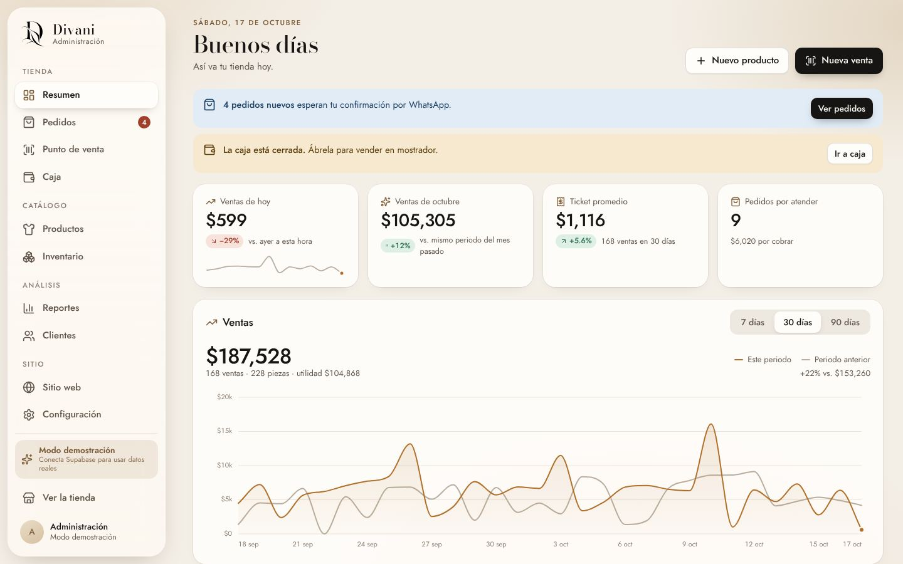
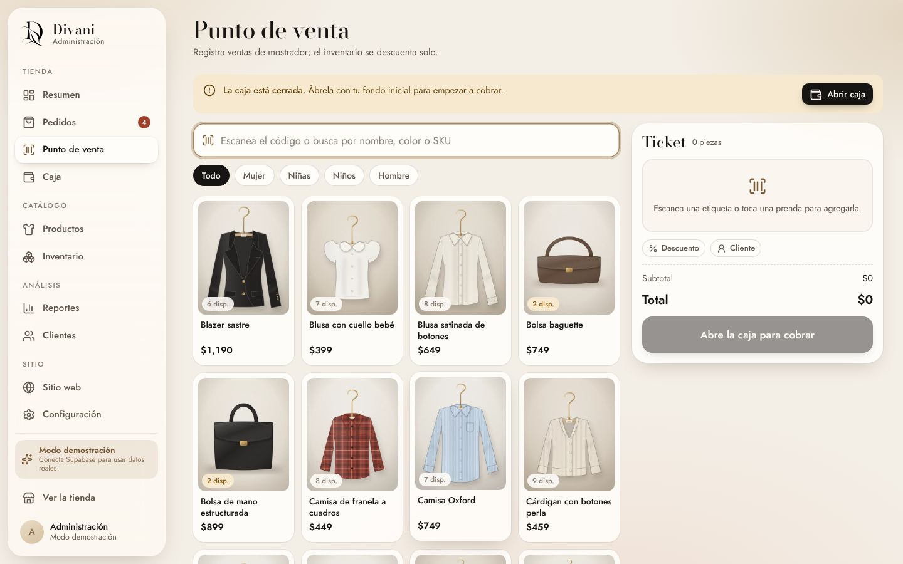
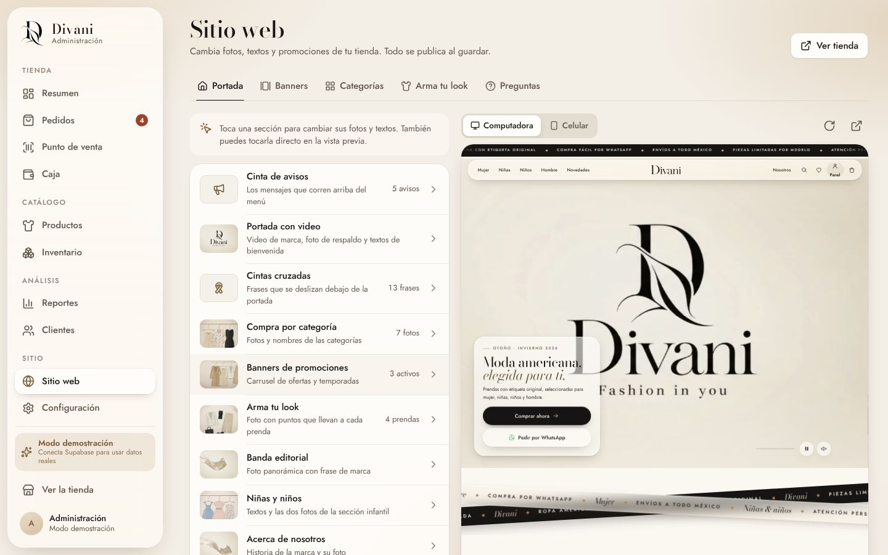
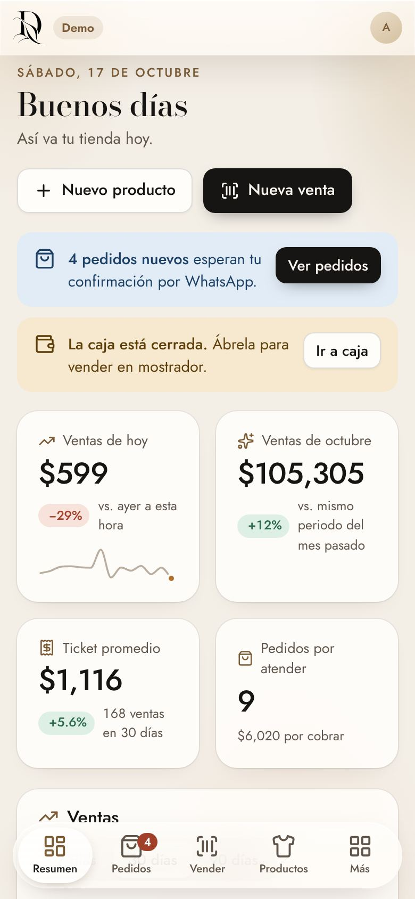

# Divani · Tienda en línea y panel de administración

Tienda de ropa americana premium con compra por WhatsApp y un panel para administrar todo: productos, inventario, pedidos, punto de venta, caja con cortes, reportes, clientes, la portada del sitio y la configuración. Base de datos en **Supabase** y fotos en **Cloudinary**; sin configurarlos, todo funciona en **modo demostración** dentro del navegador.

| Tienda (escritorio) | Tienda (celular) | Catálogo |
| --- | --- | --- |
|  |  |  |

| Panel · Resumen | Panel · Punto de venta | Panel · Sitio web | Panel en celular |
| --- | --- | --- | --- |
|  |  |  |  |

---

## Qué incluye

### Tienda (`index.html`, `tienda.html`)
- Portada con video de marca, cintas, categorías, novedades, banners, «arma tu look», niñas y niños, acerca de nosotros, cómo comprar, hombre, preguntas frecuentes y lista VIP. **Todo lo de la portada se cambia desde el panel.**
- Catálogo con filtros (departamento, categoría, talla, color, precio, ofertas), búsqueda y vista rápida con existencias **por color y talla**.
- Bolsa y pedido por WhatsApp: con base de datos, el pedido se registra primero (valida existencias y precios) y WhatsApp se abre con el número de pedido oficial.
- Precios, moneda, lada y textos según la región configurada (México, Guatemala o Estados Unidos).
- Acceso discreto a la administración (ícono de usuario, menú del celular y pie de página).

### Panel (`admin.html`)
| Sección | Qué haces ahí |
| --- | --- |
| **Resumen** | Ventas de hoy y del mes, ticket promedio, pedidos por atender, gráfica de ventas, lo más vendido, existencias y avisos. |
| **Pedidos** | Pedidos de la tienda y de WhatsApp: estados (nuevo → confirmado → en preparación → enviado → entregado), pagos, notas, mensajes listos para WhatsApp, impresión de la nota. |
| **Punto de venta** | Venta en mostrador: buscar o escanear SKU, tallas, descuentos, cobro en efectivo (con cambio), tarjeta, transferencia o mixto, ticket impreso. |
| **Caja** | Apertura con fondo, ingresos, retiros y gastos, efectivo esperado, corte con conteo por billetes y monedas, diferencias y reporte del corte. |
| **Productos** | Alta y edición con fotos por color, precios, oferta, costo y margen, tallas, SKU automático por variante y etiquetas con código de barras. |
| **Inventario** | Existencias por variante, ajustes con motivo, entrada de mercancía, kardex completo y alertas de últimas piezas. |
| **Clientes** | Se registran solas con cada pedido: historial, frecuentes, por reactivar y contacto por WhatsApp. |
| **Reportes** | Ventas por periodo con filtros (canal, método de pago, departamento, categoría, búsqueda), comparación con el periodo anterior, productos, cortes de caja y exportación a CSV/impresión. |
| **Sitio web** | Vista previa en vivo (computadora o iPhone): toca cualquier sección para cambiar sus fotos y textos. Banners con fechas, categorías, «arma tu look» con puntos sobre la foto y preguntas frecuentes. |
| **Configuración** | Tienda y contacto, región y moneda, pedidos en línea, punto de venta y caja, inventario, conexiones (Supabase y Cloudinary), cuenta y respaldo. |

---

## Probarlo ya (modo demostración)

Requisitos: **Node.js 18 o superior**.

```bash
npm install
npm run dev          # http://localhost:5173  (tienda)  ·  http://localhost:5173/admin.html  (panel)
```

En el panel presiona **«Entrar a la demostración»**: se crea un catálogo con dos meses de ventas de ejemplo en tu navegador. La tienda abierta en ese mismo navegador muestra esos datos y sus pedidos llegan al panel. Puedes reiniciar la demostración en Configuración → Respaldo y datos.

## Conectar Supabase y Cloudinary

Guía paso a paso: **[docs/CONEXION.md](docs/CONEXION.md)**. En resumen:

1. Ejecuta `supabase/schema.sql` y luego `supabase/seed.sql` en el SQL Editor de Supabase.
2. Crea el usuario administrador (Authentication → Users → Add user, con «Auto Confirm User»).
3. Cierra el registro público (Authentication → Sign In / Providers).
4. Define `VITE_SUPABASE_URL` y `VITE_SUPABASE_PUBLISHABLE_KEY` en tu hosting (o en `.env`) y vuelve a publicar.
5. En el panel → Configuración → Conexiones, guarda los datos de Cloudinary.

O los pasos 1 a 3 de una vez: `npm run setup:supabase` (ver la guía).

## Publicar

```bash
npm run build        # genera dist/
npm run preview      # revisa dist/ en http://localhost:4173
```

`dist/` es un sitio estático: Netlify, Vercel, Cloudflare Pages, GitHub Pages o cualquier hosting. Configura el comando `npm run build`, la carpeta `dist` y las variables de entorno de Supabase. Las rutas son relativas: funciona en la raíz del dominio o en una subcarpeta.

---

## Estructura

```
divani/
├── index.html · tienda.html · 404.html · aviso-de-privacidad.html   ← tienda
├── admin.html                                                        ← panel
├── supabase/            schema.sql (tablas, seguridad, funciones) · seed.sql (catálogo inicial)
├── scripts/             build-seed.mjs (genera seed.sql) · setup-supabase.mjs (prepara Supabase)
├── docs/                CONEXION.md · ARQUITECTURA.md · API.md · capturas/
├── public/              data/*.json (catálogo de muestra) · images/ · media/ · brand/ · icons/
└── src/
    ├── backend/         Reglas compartidas por tienda, panel y SQL: model.js · ops.js · seed.js · demo/ · config.js
    ├── admin/           Panel (Preact): api/ · pages/ · components/ · ui/ · lib/ · layout/ · styles/
    ├── services/api/    Origen de datos de la tienda: supabase · demo · mock (JSON) · rest
    ├── sections/        Secciones de la portada (incluye site-content.js: lo que se edita en el panel)
    ├── components/      Encabezado, hojas, bolsa y pedido, vista rápida, búsqueda, favoritos…
    ├── core/            Utilidades: DOM, formato de moneda, URL, ajustes del sitio, modo edición
    ├── store/           Bolsa y favoritos (en el navegador)
    ├── pages/ · partials/ · config/ · styles/
```

Detalles técnicos en [docs/ARQUITECTURA.md](docs/ARQUITECTURA.md). Si algún día prefieres un backend propio en lugar de Supabase, el contrato está en [docs/API.md](docs/API.md).

## Seguridad

- La página solo lleva la **clave publicable** de Supabase. Las reglas por fila (RLS) dejan que el público lea el catálogo y cree pedidos; costos, clientes, caja y reportes solo los ve el equipo con sesión iniciada.
- El **API Secret de Cloudinary** se guarda cifrado en la base de datos y solo el servidor lo usa para firmar subidas.
- Ninguna contraseña ni llave secreta vive en el código: `.env` y `.env.local` están en `.gitignore`.
- El panel no aparece en buscadores (`noindex` y `robots.txt`).

## Diseño

Mismo ADN en tienda y panel: marfil, arena y tinta, vidrio líquido estilo iOS 26, tipografías Bodoni Moda y Jost. Tokens de la tienda en `src/styles/base/tokens.css`; del panel en `src/admin/styles/base.css`. Respeta «reducir movimiento» y funciona en Safari 15+, Chrome, Edge y Firefox recientes.
